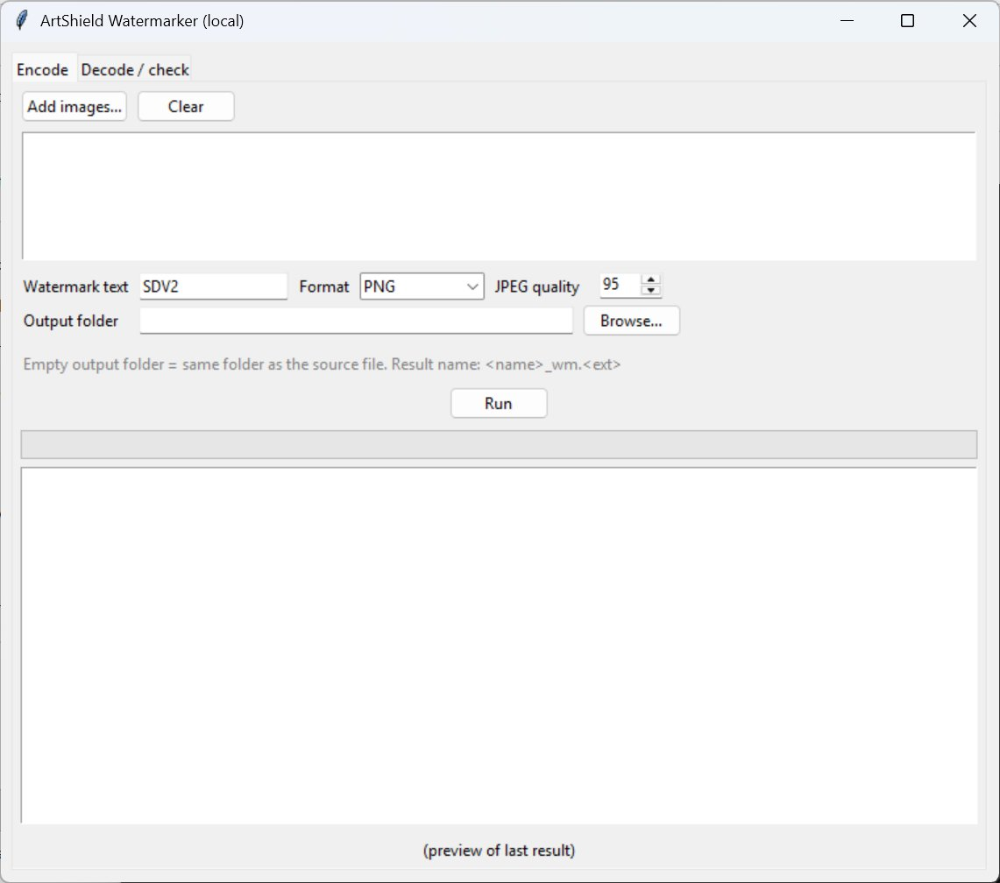

# ProtectArt

[English](README.md) | Bahasa Indonesia

Front end Tkinter (antarmuka berbahasa Inggris) untuk menjalankan [ArtShield invisible watermarker](https://artshield.io/watermarker) secara lokal. Gambar tidak diunggah ke server mana pun, dan prosesnya hanya memakai CPU.



> **Penting:** watermark ini bukan perlindungan yang kuat terhadap AI scraping atau training. Baca bagian [Batasan dan Hasil Uji](#batasan-dan-hasil-uji) sebelum mengandalkannya.

## Fitur

- Memproses banyak gambar sekaligus (batch) dengan progress bar.
- Setiap hasil dibaca ulang dan diverifikasi otomatis. Log menampilkan `[OK]` atau `[VERIFY FAILED]` beserta bit accuracy-nya.
- Format keluaran: PNG, JPEG 4:4:4, dan JPEG XL lossless (opsional, perlu plugin).
- Tab **Decode / check** untuk memeriksa apakah sebuah gambar masih membawa watermark.
- Nama hasil `<nama>_wm.<ekstensi>`. Berkas yang sudah ada tidak ditimpa.
- Preview thumbnail hasil terakhir.

## Kebutuhan

- Python 3.10 atau lebih baru
- `numpy`, `pillow`, `pywavelets`
- `tkinter` (bawaan Python; di beberapa distro Linux harus dipasang terpisah)
- Opsional: `pillow-jxl-plugin` untuk membaca dan menulis JPEG XL

## Instalasi

Mesin watermark sudah disertakan di `third_party/invisible-watermarker/`, jadi tidak ada lagi yang perlu diunduh.

```bash
git clone https://github.com/kawaii-ghost/invisible-watermarker-gui
cd invisible-watermarker-gui

pip install numpy pillow pywavelets
pip install pillow-jxl-plugin   # opsional, untuk JPEG XL
```

Struktur repo:

```
.
├── protectart.py
├── third_party/
│   └── invisible-watermarker/   # kode upstream (MIT), lihat NOTICE
│       ├── LICENSE
│       └── watermark/
├── NOTICE
├── LICENSE
└── README.md
```

Kalau `tkinter` belum ada, pasang paket sistemnya:

```bash
# Fedora
sudo dnf install python3-tkinter
# Debian/Ubuntu
sudo apt install python3-tk
```

Di Windows, `tkinter` biasanya sudah termasuk dalam installer Python resmi.

## Cara Pakai

```bash
python protectart.py
```

**Tab Encode**

1. Klik **Add images...** lalu pilih satu atau beberapa berkas.
2. Isi teks watermark (default `SDV2`, hanya ASCII, 1 sampai 16 karakter).
3. Pilih format dan folder output. Folder yang dikosongkan berarti hasil disimpan di folder berkas asal.
4. Klik **Run** dan pastikan log menampilkan `[OK]` untuk setiap berkas.

**Tab Decode / check**

1. Pilih gambar yang ingin diperiksa.
2. Pastikan teks watermark di tab Encode sama dengan yang dipakai saat encode.
3. Klik **Check watermark**. Anggap watermark terbaca hanya jika akurasinya 1.00.

### Format Keluaran

| Format | Keterangan |
|---|---|
| PNG | Aman, ukuran paling besar. |
| JPEG 4:4:4 | Lebih kecil. Pengaturan chroma subsampling dibuat 4:4:4 supaya watermark bertahan. |
| JXL lossless | Perlu `pillow-jxl-plugin`. Lebih kecil daripada PNG dan watermark tetap utuh. JXL lossy sengaja tidak disediakan karena hasilnya tidak konsisten. |

### Batasan Berkas

- Ukuran gambar harus lebih dari 256×256 piksel dan tidak lebih dari sekitar 4096×4096 piksel. Di luar rentang itu, proses ditolak.
- Keluaran selalu RGB, sehingga alpha channel dibuang. Metadata EXIF dan profil warna juga tidak ikut tersimpan.

## Batasan dan Hasil Uji

Watermark ini meniru tanda yang dipasang Stable Diffusion pada gambar buatannya, dengan harapan gambar bertanda itu disaring oleh dataset curator. Belum ada bukti bahwa pipeline training benar-benar menyaring berdasarkan tanda tersebut, dan siapa pun yang memiliki library-nya dapat membaca atau menghapusnya.

Hasil uji pada dua gambar sampel (600×600 dan 1080×1920). Angkanya bit accuracy dari 32 bit, dan 0,5 setara tebakan acak. Gambar tanpa watermark pun mendapat 0,56 sampai 0,66.

| Perlakuan setelah watermark | Bit accuracy |
|---|---|
| Tanpa perubahan (PNG, JPEG 4:4:4, JXL lossless) | 1,00 |
| JPEG q60 sampai q95 dengan chroma 4:4:4 | 1,00 |
| JPEG q75 sampai q95 dengan chroma 4:2:0 | 0,59 sampai 0,72 |
| Resize 50% | 0,50 sampai 0,59 |
| Crop 3% atau 8 piksel | 0,38 sampai 0,41 |
| JXL lossy q95 / q90 / q85 | bergantung pada gambar (0,59 sampai 1,00) |

Artinya watermark hanya bertahan jika gambar tidak diubah lagi atau dikompresi ulang dengan JPEG 4:4:4 atau JXL lossless. Platform yang mengompresi ulang dengan chroma 4:2:0, mengubah ukuran atau memotong gambar kemungkinan besar menghapusnya. Selalu unggah, unduh ulang, lalu periksa di tab Decode.

Keterbatasan pengujian: hanya dua gambar dan hanya encoder JPEG dari Pillow sehingga hasil di platform tertentu bisa berbeda.

### Urutan Kerja yang Disarankan

Kalau dipakai bersama alat proteksi lain seperti Glaze atau Mist, pasang watermark paling akhir, karena transformasi pixel apa pun sesudahnya dapat merusaknya:

1. Selesaikan karya, termasuk crop dan resize ke ukuran unggah.
2. Terapkan Glaze atau Mist.
3. Terapkan watermark dengan GUI ini dan pastikan log menampilkan `[OK]`.
4. Unggah lalu periksa hasil unduhannya di tab Decode.

Kombinasi dengan Glaze atau Mist belum diuji. Perturbasi mereka dapat memengaruhi pembacaan watermark sehingga verifikasi tetap wajib.

## Cara Kerja Singkat

Mesin dasarnya sama dengan `EmbedMaxDct` pada library `invisible-watermark`:

1. Gambar dikonversi ke YUV dan hanya kanal U (chroma) yang diubah.
2. Kanal itu diurai dengan Haar DWT, lalu pita LL dibagi menjadi blok 4×4.
3. Setiap blok menyimpan satu bit dengan mengkuantisasi koefisien terbesarnya (step 36). Bit yang sama diulang di seluruh blok.
4. Saat decode, hasil dari seluruh blok digabung dengan suara terbanyak.

Payload default `SDV2` berasal dari skrip txt2img resmi Stable Diffusion 2.x. Detail algoritmanya ada di kode upstream.

## Pemecahan Masalah

| Gejala | Penyebab dan solusi |
|---|---|
| `No module named 'tkinter'` | Pasang paket sistem seperti di bagian Instalasi. |
| `Image is too small` | Ukuran gambar kurang dari 256×256 piksel. |
| Opsi JXL tidak muncul | Jalankan `pip install pillow-jxl-plugin` di environment yang sama. |
| `[VERIFY FAILED]` | Watermark tidak terbaca setelah disimpan. Jangan diunggah. Coba format lain, misalnya PNG. |
| Banyak baris `~~~~` di terminal | Itu `print` debug dari kode upstream. GUI sudah membungkamnya, tetapi baris itu bisa muncul bila kode dijalankan langsung. |

## Kredit dan Lisensi

- Mesin watermark adalah kode [invisible-watermarker](https://github.com/Alcas1/invisible-watermarker) oleh Jonathan Wu dan Alice Xie (dipakai di artshield.io), yang diturunkan dari library [`invisible-watermark`](https://github.com/ShieldMnt/invisible-watermark) oleh ShieldMnt. Keduanya berlisensi MIT. Salinannya disertakan di `third_party/invisible-watermarker/`; lihat [NOTICE](NOTICE) untuk isi yang disertakan dan yang dibuang.
- Proyek ini tidak berafiliasi dengan ArtShield, Stability AI, maupun pengembang upstream.
- Sebagian proyek ini ditulis dengan bantuan AI (Claude, buatan Anthropic) dan ditinjau oleh `<nama kamu>`.
- Berkas GUI dirilis dengan lisensi MIT. Kode upstream yang disertakan tetap memakai [LICENSE](third_party/invisible-watermarker/LICENSE)-nya sendiri. Kalau kamu mendistribusikan ulang repo ini, **pertahankan berkas itu beserta pemberitahuan hak ciptanya**.

```
MIT License

Copyright (c) 2026 Kawaii Ghost
```

## Penafian

Perangkat lunak ini disediakan apa adanya tanpa jaminan apa pun. Tidak ada alat proteksi karya yang menjamin keamanan penuh dari penyalinan atau pelatihan AI. Anggap watermark sebagai satu lapisan tambahan bukan pengganti langkah lain.
